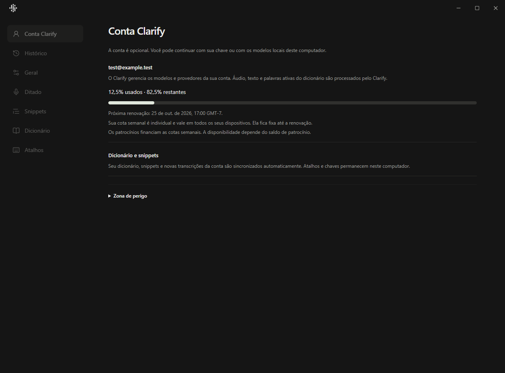
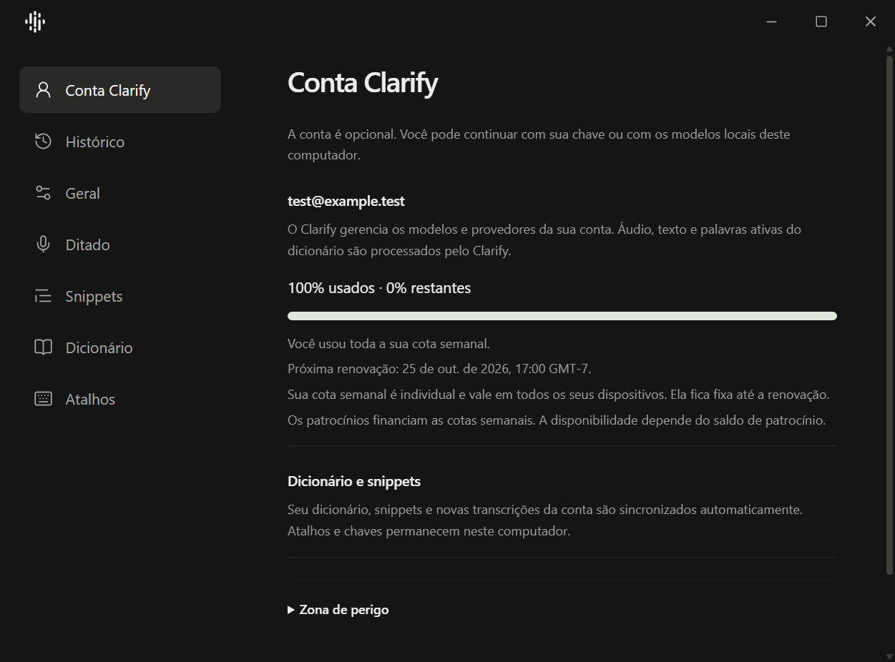

# Windows validation

Validation date: 2026-10-25. The runtime candidate contains the 66 files reviewed
after the Windows test repairs, on base
`b0e095f0336e74779d5004f4b88016df1bfe2121`. All 709 exported source files matched
the candidate by SHA-256, including the two test repairs. This report and its
screenshots were added after that comparison.

The tests used Windows 11 build 26200, Python 3.12.10, Node 22.14.0, Rust 1.94.0
and the native Edge WebView2 runtime. Python, npm and Cargo used the repository's
locked dependencies. Qt used PySide6-Essentials without Addons.

Profiles, caches, databases and build outputs were disposable. Tests used fake
accounts and provider responses. No real microphone recording or paid provider
request was made. The installed application and its profile were preserved.

## Completed checks

| Check | Result |
| --- | --- |
| Windows Python suite | 1,371 tests run, 5 skipped; exit 0 |
| Windows skills, locale and focused mypy checks | Passed; exit 0 |
| Settings release build | Passed; native executable and inventory of 301 components |
| Full Edge Settings suite | 43 tests passed; exit 0 |
| Native Settings IPC | Model and multiline snippet persistence, dirty close/cancel/discard and process exit passed |
| Native window controls | Rounded corners, maximize, restore, titlebar double-click, minimize and clean close passed |
| Native dictionary | Add, save and navigation passed |
| Native weekly quota | All 10 WebView2 scenarios passed; exit 0 |
| Complete portable package | Official `deploy.ps1 -BuildOnly` passed; imports and embedded Settings/catalog/inventory checks passed |
| Packaged inputs | All 22 QML/JavaScript assets matched; no `.env` or private `config.json` in the archive |
| Packaged lifecycle | Hidden startup, visibility hotkey, one logical instance, native window flags and close-to-tray passed; exit 0 |

Quota scenarios covered available, exhausted, waiting, unfunded, inactive,
paused, legacy and malformed usage. Exhaustion was checked in Portuguese,
English and Spanish. The Portuguese exhausted screen also ran at scale 150%.
The tests checked percentages, the absence of raw billing units, local reset
conversion, no horizontal overflow and clean shutdown. The local-time check
used a WebView2 timezone override for `America/Los_Angeles`; it did not change
the Windows timezone.

The full Windows suite also passed the real DPAPI round trip and the Qt/QML
smoke checks. The Linux/server/mobile results remain separate: 1,371 root tests
with 4 skipped, 184 PostgreSQL tests, 21 mobile JavaScript tests, mobile
typechecking and clean migration application all passed.

## Test repairs

The first Edge run passed 42 tests and failed one explicit quota refresh. The
test helper allowed an automatic refresh to race that request. Quota tests now
return real controller snapshots for automatic refresh while exercising explicit
refresh and retry. Other tests retain automatic refresh. Production guards did
not change. The complete 43-test rerun passed.

The first Python run failed a Qt transition check after a fixed 400 ms delay.
An isolated rerun passed. The check now processes Qt events until the expected
surface has opacity exactly 1, with a three-second limit. Both intermediate
60 ms animation checks remain. The complete Windows rerun passed.

A fresh read-only review found no blockers or confirmed actionable defects in
these repairs. The two earlier independent reviews of requirements and
engineering also finished without blockers. Product code did not change during
the Windows repairs.

The first packaged lifecycle attempt encountered shortcut conflicts with an
unrelated installed Clarify instance. That instance was preserved. The disposable
test profile then used `Ctrl+Alt+Shift+F20` through `F24`, and the rerun passed.
The packaged toolbar measured 162 by 52 pixels at 120 DPI. A second launch exited
with code 0, leaving one logical application with its two PyInstaller processes.
The visibility check sent `WM_HOTKEY` to the owned window. Secondary-launch
activation was not asserted because the installed instance shares the native
activation event. No physical shortcut or tray-menu interaction is claimed.

## Artifact identity

The portable package was built for validation with `-BuildOnly`. It was not
installed or published.

| Artifact | SHA-256 |
| --- | --- |
| `Clarify.exe` | `68aff8d68e00b1a4b86680df0367aa380be0b32882ffeddd3374bb0f805e467d` |
| `clarify-settings.exe` | `0ab185d38cc85d7edce9e0c510fb8536de534b318a1f5a569924e1358e51db6e` |

## Native screenshots

Available quota at scale 100%:

Exhausted quota at scale 150%, with the local reset time:

These captures use a test account. They show the completed interface; no baseline
screenshot was captured during this validation.

## Open acceptance limits

The native checks used automation and visual inspection of screenshots. Human
acceptance with real recording, foreground application focus, paste targets and
live providers remains a release check. Native iPhone/Swift acceptance was not
performed in this Windows task.

Stripe remains unconfigured. Its tests use fake HTTP responses. No Stripe account,
payment, production financial entry or live synchronization was created.
The changes have not been installed over the user's application or released.
