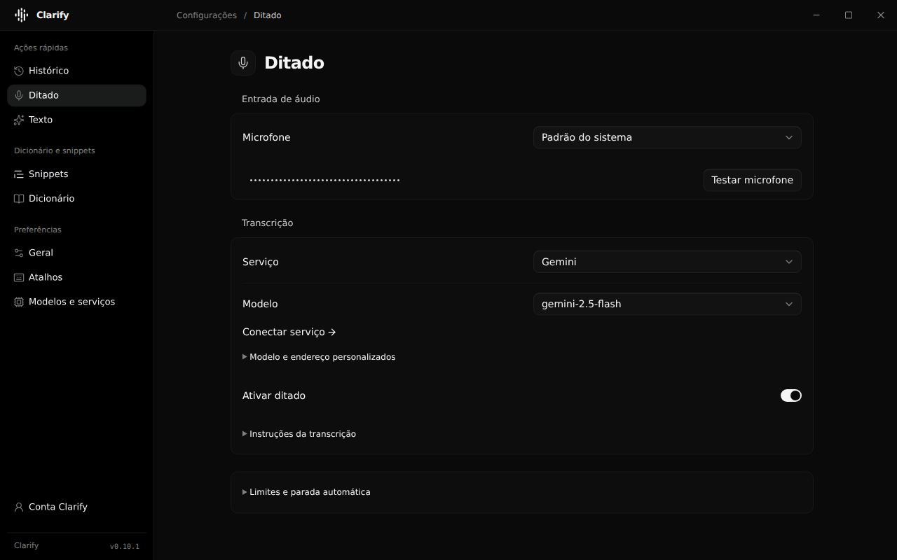
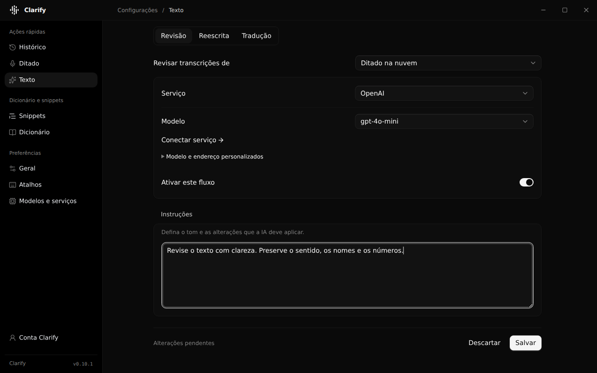

# Desktop design system

The React/Tauri Settings window uses one dark neutral palette and shared React
controls. Its pages include account access, onboarding, history, dictation, text,
dictionary, snippets, shortcuts, models and general preferences. The Qt/QML pill,
quick menus and launch-failure Settings fallback retain their own theme and
behavior. Mobile and the server are outside this system.

## Tokens and typography

`desktop/src/styles/tokens.css` owns the semantic values. Earlier `--color-*`
names remain aliases for page styles. Do not create a second palette in a page.
`styles.css` maps the semantic roles into Tailwind utilities. Document defaults
use the base layer, shared and feature layouts use the components layer, and
primitive utilities provide the final control states.

| Role | Value or rule |
| --- | --- |
| Canvas / main text | `#0a0a0a` / `#f5f5f5` |
| Card / popover | `#111111` |
| Muted text / placeholder | `#818181` |
| Primary / primary text | `#f5f5f5` / `#0a0a0a` |
| Focus / error | `#d4d4d4` / `#edb2a5` |
| Border / input border | `#191919` / `#1e1e1e` |
| Sidebar / hover / selection | `#000000` / `#131313` / `#1a1b1b` |
| Typography | OS sans; 14 px body and controls, 12 px help, 11 px metadata |
| Geometry | 32 px default desktop controls; 8 px button radius; 10 px field radius |
| Spacing | 4, 8, 12, 16, 20, 24 and 32 px |
| Motion | 120–200 ms; reduced-motion override; stable page navigation |

The root font size is 16 px so rem-based control geometry remains predictable.
The body is 14 px. Fonts use the operating system; no remote font is loaded.
Use monospace for shortcuts, versions and technical metadata. Error and warning
states need text as well as color. Lucide supplies shared icons.

## Reusable controls

`components/primitives/` contains the reusable Base UI components. Their
composition, Tailwind variants, `data-slot` names and state attributes form the
common control layer. Keep Base UI imports there rather than rebuilding keyboard,
focus, disabled or popup behavior in feature pages. `lib/utils.ts` merges
conditional utilities and resolves conflicting Tailwind classes.

Pages use the feature-facing facade in `components/ui.tsx`:

- `Button`: outline, primary, ghost and inline actions, default button type,
  loading state and disabled handling.
- `Input` and `TextArea`: styled shells around native editable controls. Preserve
  native events, input type, refs, form submission and accessible descriptions.
- `Row` and `Field`: associated labels and help text, with aligned controls.
- `Switch` and `Toggle`: labeled binary state, using the shared switch primitive.
- `Section`: a quiet heading outside a grouped panel with internal dividers.
- `Confirm`: controlled modal dialog with title, description and explicit actions.
- `Picker`: searchable combobox with stable option IDs, keyboard selection,
  selected state, refresh, empty state and focus return.

`components/settings-navigation.tsx` renders grouped page buttons from the shared
button primitive. Navigation remains available while a preference, refresh, or
text save is pending. Settings has no global search; dropdowns and libraries keep
their local filters.

`components/titlebar.tsx` owns the native drag region, identity, page context and
existing minimize, maximize and close commands. Page geometry belongs in
`styles/pages.css` and `styles/snippets.css`; window geometry belongs in
`styles/layout.css`. Reuse the facade instead of copying control styles.

## Desktop UX contracts

Python remains the only owner of configuration, accounts, secrets, audio,
history and workflow effects. UI components do not add a bridge command, data
migration or external service.

Switches, selection lists and shortcuts save automatically through a targeted
preference command. An automatic save must not commit unrelated text drafts.
Existing library flags save only the selected flag under its account context.
New library entries remain drafts until explicitly saved.

Free text and numeric fields retain contextual Save/Discard actions in the page
flow. Navigation retains drafts by workflow and never stages them merely by
opening another page. Closing with pending text uses the unsaved-change
confirmation, including an explicit save-all action. Saving one page preserves
unsaved edits elsewhere and edits made after the save began.

Pending state belongs to the affected operation. The sidebar and unrelated
controls do not dim or become disabled for microphone tests, list refreshes,
saves or discards. A workflow page can show local loading while its route data
arrives. Async completions must not replace a later navigation or text edit.

The titlebar and sidebar stay fixed. Page headings scroll with the content.
The content is centered and bounded. At 820 px, navigation remains labeled;
at 640 px, it becomes an icon rail with accessible names and hover titles. Controls stack when needed. Library and history text can wrap and remain
available in full; layout must not truncate persisted content.

Authentication keeps full-width forms through each step. Managed accounts hide
personal providers. Destructive operations keep their confirmation and account
context checks. Opening a screen does not acquire the microphone or submit an
authentication request.

## Validation

The screenshots below use the isolated controller fixture, with no user profile
or live audio. The text screen shows contextual actions inside the page.

Use `desktop/tests/settings.spec.ts` with `tests/web_settings_fixture.py` for
isolated controller-backed browser checks. Cover labels, help, keyboard, focus,
local filters, automatic preferences, drafts, managed accounts and 640/820/1040 px geometry. Run the Python
suite and the TypeScript/production build. Native Windows checks cover the
Tauri/QProcess boundary and the actual window.

Automated checks establish only the tested interactions. Manual Windows
acceptance of DPI, global hotkeys, tray, transparency and passive pill focus
remains a separate gate. See [desktop responsiveness](desktop-performance.md)
for state ownership, measurements and their limits.
